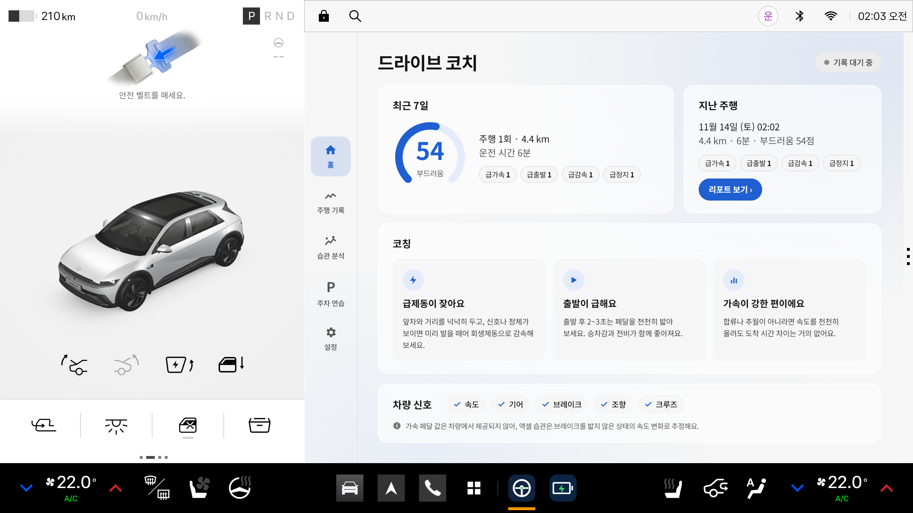
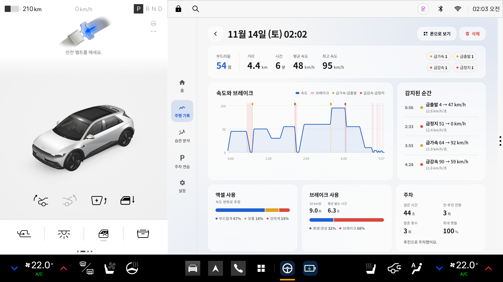
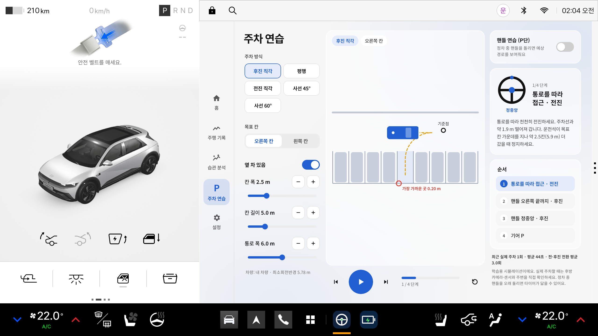
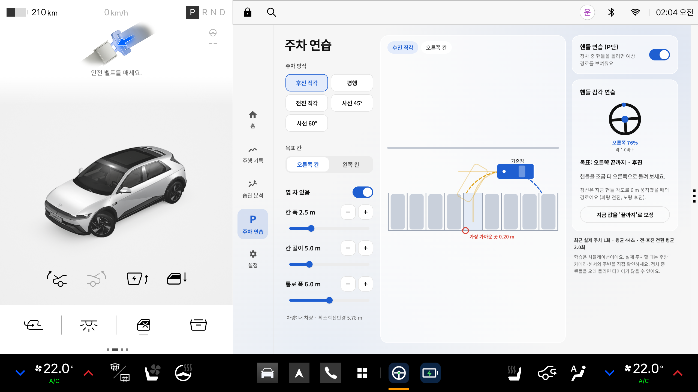
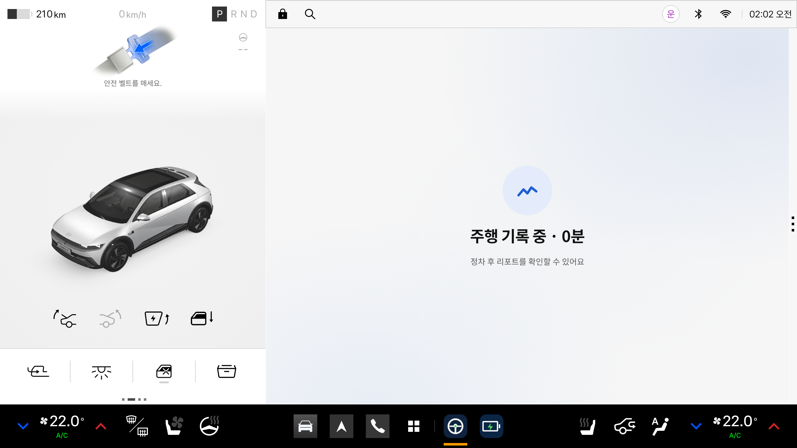
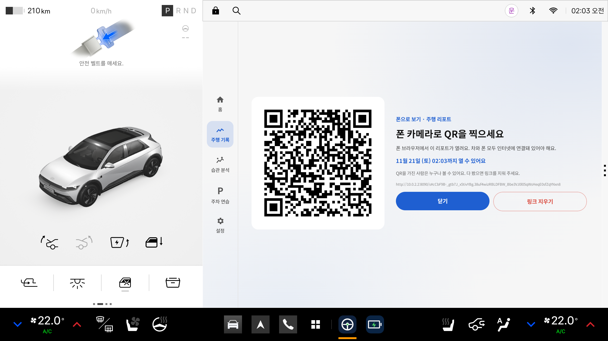
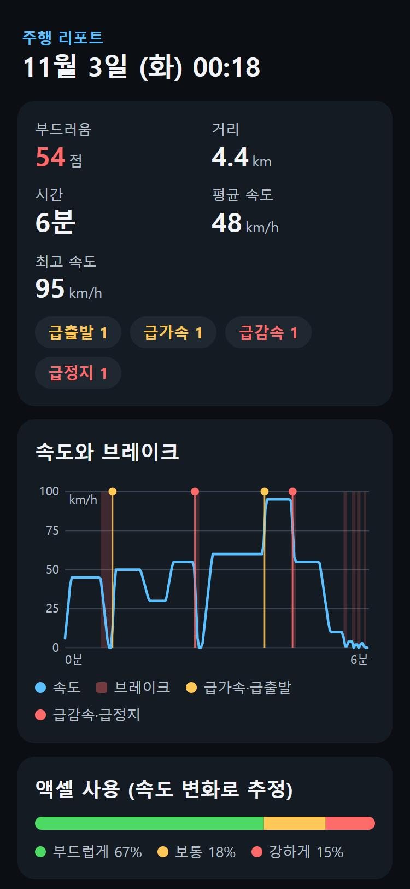

# 드라이브 코치 — 운전 습관 리포트 + 주차 연습 (Pleos Connect)

평소 운전 습관(액셀·브레이크 사용, 급가속·급제동)을 차량 안에서 기록해 주행이 끝나면 리포트와 코칭을 보여 주고,
주차를 미리 시뮬레이션해서 "어디서 멈추고, 핸들을 얼마나 꺾고, 어떻게 들어가는지" 알려 주는 앱입니다.
같은 저장소의 EV Companion(`:app`)과 별도 앱이며, 차량 공통 코드는 `:core-vehicle` 를 함께 씁니다.

| 홈 | 주행 리포트 |
| --- | --- |
|  |  |

| 주차 시뮬레이션 | P단 핸들 연습 (실제 핸들 연동) | 주행 중 (규제) |
| --- | --- | --- |
|  |  |  |

| 폰으로 보기: 차 화면의 QR | 폰 브라우저 (375 px, 같은 주행) |
| --- | --- |
|  |  |

## 기능
- **주행 기록**: 동의한 경우에만 포그라운드 서비스가 기어·속도로 트립을 나눠 기록합니다 (P 진입 후 3분 유지 또는 시동 OFF 로 마감, 120초 넘게 신호가 없으면 마지막 샘플에서 마감).
  300 m 미만 이동은 "주차·짧은 이동"으로만 저장합니다. 1분마다 암호화 청크를 추가 저장해 프로세스가 죽어도 다음 시작 때 복구합니다.
  부팅 후에는 앱을 열지 않아도 기록이 다시 시작됩니다(설정에서 끌 수 있음). 에뮬레이터 재부팅으로 확인: 부팅 약 1분 뒤 `BOOT_COMPLETED` 예외로 포그라운드 서비스가 시작되고 권한도 그대로 유지되며,
  앱을 한 번도 열지 않은 채 VC 로 30 km/h 70초 주행하면 0.6 km 트립과 리포트 알림("0.6 km · 부드러움 80점")이 생깁니다.
- **습관 분석**: 급가속·급출발(≥ 2.8 m/s²), 급감속·급정지(≤ −3.0 m/s²), 가속 직후 제동, 가속 강도 분포(부드럽게/보통/강하게),
  브레이크 횟수·평균 밟는 시간, **브레이크 없이 감속한 비율**(회생·관성, 에너지 가중), 크루즈 구간 제외, 주차 세션(소요 시간·전·후진 전환·최대 핸들).
  "부드러움 점수" = 100 − (가중 이벤트 수 / 10 km). 기준값은 `analysis/Thresholds.kt` 한 곳에 있습니다.
- **주차 연습**: 후진 직각·평행·전진 직각·사선 45°/60°, 좌/우 칸, 칸·통로 크기, 옆 차 유무. 핸들 끝까지 원호 + 직진 템플릿을
  격자 탐색해 옆 차 0.25 m·벽 0.15 m·연석 0.10 m 여유를 지키는 경로를 고르고, 단계별 안내(핸들 방향·끝까지의 %·기준점)와 애니메이션을 보여 줍니다.
  안 들어가면 필요한 통로 폭/칸 길이를 알려 줍니다(예: 아이오닉 5 는 옆 차가 있는 6.0 m 통로에서 전진 직각주차가 한 번에 안 됨 → 약 6.5 m 필요).
- **P단 핸들 연습**: P단(또는 주차 브레이크) + 규제 해제 + 조향 신호가 있을 때 실제 핸들 각도로 전·후진 예상 경로(6 m)를 그리고 목표와 비교합니다. 신호가 없으면 슬라이더.
- **폰으로 보기**: 주행 리포트나 습관 분석(7·30·90일)에서 누르면, 그 리포트를 차에서 암호화한 사본을 공유 서버(`:share-server`)에 7일 올리고
  QR을 보여 줍니다. 폰 카메라로 찍으면 폰 브라우저가 내려받아 브라우저 안에서 복호화해 보여 줍니다(아래 "폰으로 보기" 절).
- **화면**(2026-11-14 디자인 적용): 디자인 시안의 치수·색을 그대로 옮긴 150 dp 탭 레일과 카드 화면입니다. 색은 `ui/theme/Theme.kt` 의
  라이트·다크 팔레트 두 벌이고 설정 > 화면 > 다크 모드로 바꿉니다(기본 라이트, `Settings.darkMode`). 부품은 `ui/components/Components.kt`,
  아이콘은 `ui/components/Icons.kt`, 글꼴은 Noto Sans KR 가변 글꼴(`res/font/notosanskr_vf.ttf`, SIL OFL 1.1, 라이선스 `assets/licenses/NotoSansKR-OFL.txt`)입니다.
  내용 폭 1100 dp 이상(가로 전체 창)에서는 시안처럼 카드를 나란히 놓고, 세로 분할 창(841 dp)에서는 한 열로 쌓습니다(`ui/components/Adaptive.kt`).
  버튼은 시안의 크기로 그리되 누르는 영역은 64 dp 이상입니다. 주차 그림은 실제 치수(m)로 계산한 경로를 시안의 선·색으로 그립니다(`ui/parking/ParkingCanvas.kt`).
  위 스크린샷은 debug 빌드의 데모 주행(설정 > 개발용)으로 만든 기록입니다.

## 폰으로 보기 (서버 링크, 종단간 암호화)
| 단계 | 어디서 | 무엇을 |
| --- | --- | --- |
| 1. 선택 동의 | 차, 처음 한 번 | 올라가는 항목·목적·7일 보관·"링크를 가진 사람은 볼 수 있음"·거부 권리. 버튼으로만 동의, 기록 동의와 별개(`Settings.shareConsentVersion`) |
| 2. 봉인 | 차 `share/ShareCrypto` | 리포트용 DTO(`share/ShareModels.kt`, ODO·조향·트립 id·차량명 제외, 그래프 최대 300점) → 공유마다 새 AES-256 키, AES-GCM. 블롭 `DCS1 \| flags \| iv \| 암호문+태그` |
| 3. 업로드 | 차 → 서버 `POST /v1/shares` | `application/octet-stream` 만, 256 KB 이하. 서버는 `{id, deleteToken, ttlMs}` 를 돌려주고 블롭과 토큰의 SHA-256 만 저장 |
| 4. QR | 차 화면 | `https://<공개 주소>/s#<id>.<key>` — id 와 키 모두 URL 조각(#)에만 있어 서버·프록시 로그에 남지 않음 |
| 5. 보기 | 폰 브라우저 `/s` | 조각에서 id·키를 읽고 주소창에서 지운 뒤 `Authorization: Bearer <id>` 로 암호문을 받아 WebCrypto 로 복호화, 글자만 넣어 그림(다른 사람이 만든 QR도 열릴 수 있으므로 신뢰하지 않는 입력으로 처리) |
| 6. 지우기 | 차 | 공유 화면 "링크 지우기", 설정 "모두 지우기"·동의 철회, 주행 기록 삭제 시 그 링크도. 실패한 삭제는 별도 Keystore 키로 저장한 대기열에서 앱 시작 때 재시도 |

- 서버는 암호화된 사본만 가진다. 푸는 키는 QR 에만 있고 차에도 저장하지 않으므로(대상마다 링크 1개, 다시 공유하면 새 링크), QR 다시 보기는 없다.
  다만 서버가 뷰어 스크립트를 내려주므로 "운영자가 절대 못 본다"가 아니라 "서버에는 암호화된 사본만"이라고 안내한다. 릴리스 빌드는 QR 주소를 BuildConfig 의 https 주소로만 만든다.
- 뷰어는 `history.replaceState` 로 키를 주소창·방문 기록에서 지우고, 같은 폰에서 다시 열 수 있도록 만료까지 `localStorage` 에 {id, 키, 만료} 를 둔다(조각 없이 `/s` 를 열면 목록).
  CSP `default-src 'none'; script-src 'self'; … require-trusted-types-for 'script'`, `Referrer-Policy: no-referrer`, 모든 응답 `no-store`.
- 서버 id 는 정규식 검사 후 파일 이름을 `hex(SHA-256(id))` 로 해서 경로 조작이 불가능하고, 모든 실패는 같은 404. 요청 제한: 생성 30/시간·조회 120/분(주소별).
- 주행이 시작되면(규제) 공유 화면을 닫는다(`UX_RESTRICTIONS_NO_SETUP_QR_SCAN`). 업로드 중에 닫혀도 id·토큰은 응답 즉시 저장돼 지울 수 있다.
- 에뮬레이터 실측(2026-11-04, emulator-5556 → PC 서버): 선택 동의 → QR → 링크를 폰 폭 브라우저에서 열면 차와 같은 리포트(점수·그래프·비율 일치),
  차에서 "링크 지우기" 후 폰은 "링크가 만료됐거나 지워졌어요", 기간 공유, 설정 "모두 지우기" 후 서버 파일 0개, 서버 로그에 id 없음.
  staging(R8) 빌드도 차량 신호 5개 연결 + 업로드·QR·삭제 정상.

**실행·시연** (WebCrypto 는 https 또는 localhost 에서만 동작하므로 실제 폰에는 https 주소가 필요)
```powershell
$env:JAVA_HOME = "D:\Android Studio\jbr"
.\gradlew.bat :share-server:installDist
# PowerShell 에서 실행 (bin\share-server.bat 은 경로의 쉼표 때문에 안 됨). 에뮬레이터는 http://10.0.2.2:8090 으로 올림.
& "$env:JAVA_HOME\bin\java.exe" -cp "share-server\build\install\share-server\lib\*" com.example.drivecoach.share.server.ApplicationKt
# 실제 폰: https 터널(계정 불필요)을 열고, 그 주소를 서버에 알려 주면 debug/staging 앱이 QR 에 그 주소를 넣음
cloudflared tunnel --url http://localhost:8090          # → https://<무작위>.trycloudflare.com
$env:PUBLIC_BASE_URL = "https://<무작위>.trycloudflare.com"   # 서버를 다시 시작
```
- 서버 env: `PORT`(8090)·`HOST`(127.0.0.1)·`DATA_DIR`(data)·`TTL_HOURS`(168)·`MAX_BYTES`(256 KB)·`QUOTA_BYTES`·`CREATE_PER_HOUR`·`READ_PER_MINUTE`·`TRUST_PROXY`·`PUBLIC_BASE_URL`.
- 앱 local.properties: `share.baseUrl`(debug/staging 업로드, 기본 `http://10.0.2.2:8090`), `share.viewBaseUrl`(QR 주소 고정), `share.releaseBaseUrl`(릴리스, https 필수, 비면 기능 숨김).
- 시연: 행사장 네트워크에서 미리 연습(UDP 가 막히면 `cloudflared tunnel --protocol http2 …`), 폰은 LTE, 실패 대비 녹화 영상. 터널 주소는 실행할 때마다 바뀌므로 서버를 다시 시작.
- 운영 배포(이번 범위 밖): `deploy/` 의 Caddy 앞에 별도 도메인 사이트 블록(`/v1/*`, `/s`, `/assets/*` 만 프록시, 접근 로그 끔) + `share-server` 컨테이너.

## 구조
```
core-vehicle/  com.example.pleos.core          PleosErrors, car/CarBridge, car/UxRestrictionsMonitor(isDriving, available)
drivecoach/    com.example.drivecoach
  vehicle/   VehicleHub(앱 단위 1개 연결, 참조 카운트) · PleosDriveSignals(조향·브레이크·크루즈·ODO) · AaosDriveSignals(속도·기어·주차브레이크·시동·제원) · DrivingState
  record/    DriveRecorderService(specialUse FGS) · TripRecorder · RecorderController · BootReceiver · RecorderNotification
  analysis/  TripSegmenter · AccelEstimator · EventDetector · HabitAccumulator · ParkingSessionDetector · TripAnalyzer · Insights(점수·코칭)   ← 순수 Kotlin
  parking/   Geometry · VehicleGeometry(+프리셋) · ScenarioLayout · ParkingPlanner                                                         ← 순수 Kotlin
  data/      Crypto(Keystore AES-256-GCM, AeadCodec) · TripStore(암호화 파일) · ShareStore(링크 삭제 정보, 별도 키) · Settings(민감하지 않은 설정만)
  share/     ShareModels(전송 DTO) · SharePayloads · ShareCrypto(+ShareLink) · ShareClient(HttpURLConnection) · ShareManager   ← 순수 Kotlin
  ui/        DriveCoachRoot(탭 레일) · consent · home · trips · habits · parking · settings · share(QR) · driving · components
  src/debug  sim/ScriptedDrives · SimulationPlayer (데모 주행, 릴리스 미포함) / src/release 는 실제 신호만 (staging 도 release 소스 사용)
share-server/  com.example.drivecoach.share.server   Ktor: BlobStore(공유당 파일 1개) · routes/ShareRoutes · 보안 헤더 · resources/viewer(폰 뷰어 HTML/JS/CSS)
```

## 차량 신호와 권한 (Pleos Connect Emulator v2.1.0 실측, 2026-11-03)
| 신호 | 출처 | 권한 | 에뮬레이터 |
| --- | --- | --- | --- |
| 속도 | AAOS `PERF_VEHICLE_SPEED` 10 Hz | `android.car.permission.CAR_SPEED` (dangerous) | ✓ (권한 허용 직후 재구독, 재시작 불필요) |
| 기어 | AAOS `GEAR_SELECTION` | `CAR_POWERTRAIN` | ✓ VC 기어(VENDOR_GEAR_SELECTION)를 따라감 |
| 주차 브레이크 / 시동 | `PARKING_BRAKE_ON` / `IGNITION_STATE` | `CAR_POWERTRAIN` | ✓ / 미지원 |
| 브레이크 페달 | Pleos `getBrake()` (눌림 여부만) | `pleos.car.permission.CAR_DRIVE` | ✓ |
| 조향 | Pleos `getSteeringWheel()` (왼쪽 음수) | `CAR_DRIVE` | ✓ capability 범위 ±500 → 핸들각 단위로 판단 |
| 크루즈 / ODO | Pleos `getDrivingMode()` / `getOdometer()` | `CAR_DRIVE` | ✓ / 0.0 km |
| 차량 제원 | AAOS `INFO_EXTERIOR_DIMENSIONS` | `CAR_INFO` | ✓ AOSP 기본값(4950×2008, 축거 2984, 11800 → 직경으로 판별, 회전반경 5.78 m) |
| 회생 단계 / 정차 모드 | `EV_BRAKE_REGENERATION_LEVEL` / `EV_STOPPING_MODE` | `CAR_POWERTRAIN` | 0 / 1(CREEP) |

- 가속 페달 개도·브레이크 %·IMU·초음파·카메라는 3rd-party 앱이 읽을 수 없습니다 → 액셀 습관은 "브레이크를 안 밟은 상태의 속도 증가율"로 추정하고 앱에 그렇게 표시합니다.
- **`CAR_SPEED` 는 AAOS 에서 위치 권한 그룹이라 허용 창이 "위치 정보 액세스"로 뜹니다.** 동의 화면에서 미리 설명합니다(GPS 위치는 읽지 않음).
- 주행 규제: VC 기어를 D 로 두면 driving state IDLING + UX 제한 0x50(DO 필수)이 걸리고 앱이 정적인 "주행 기록 중" 화면으로 바뀝니다. P 로 돌리면 해제.
  이 에뮬레이터에는 `cmd hmg_car_service`(driving_regulation 토글)가 없고, `cmd car_service get-property-value/inject-vhal-event` 는 user 빌드라 막혀 있습니다.

## Virtual Console 로 실제 경로 검증
쓰기는 하트비트 직후에만 받습니다(`scripts/pleos-vc.ps1` 가 처리).
```powershell
pwsh -File scripts/pleos-vc.ps1 -Gear D -SpeedKph 30      # 트립 시작 (속도는 정수 km/h 만: 30.5 는 invalid_speed)
pwsh -File scripts/pleos-vc.ps1 -BrakePct 100 -SpeedKph 10
pwsh -File scripts/pleos-vc.ps1 -SteeringDeg -470          # VC 의 + 는 왼쪽 (SDK 에는 부호가 바뀌어 들어옴)
pwsh -File scripts/pleos-vc.ps1 -Gear P -SpeedKph 0 -BrakePct 0 -SteeringDeg 0   # 원상복구 (P 3분 뒤 트립 마감)
```
속도를 바꿀 수 없는 환경에서는 debug 빌드의 설정 → "데모 주행"(도심·고속도로·주차만, 1×/10×)이 같은 파이프라인으로 흘러갑니다.

## 빌드·테스트
PowerShell 에서 실행하세요(경로의 쉼표 때문에 cmd/Git Bash 는 안 됨).
```powershell
$env:JAVA_HOME = "D:\Android Studio\jbr"
.\gradlew.bat :drivecoach:testDebugUnitTest      # 76 tests: 분석·세그먼트·저장(암호화)·주차 플래너·데모 주행 재생·폰으로 보기(봉인·DTO·클라이언트·관리자)·화면 계산(디자인 헬퍼, 주차 그림 범위)
.\gradlew.bat :share-server:test                 # 16 tests: 생성·조회·삭제·만료·415/413/507/429·보안 헤더·로그와 파일에 id 없음
.\gradlew.bat :drivecoach:assembleDebug          # 릴리스(R8): :drivecoach:assembleRelease, R8 을 에뮬레이터에서: :drivecoach:assembleStaging
& "$env:LOCALAPPDATA\Android\Sdk\platform-tools\adb.exe" install -r drivecoach\build\outputs\apk\debug\drivecoach-debug.apk
```
`:drivecoach:testDebugUnitTest` 는 뷰어 확인용 테스트 벡터(`drivecoach/build/share-fixture/{trip,period}.{bin,key}`)도 만듭니다:
서버에 `.bin` 을 올린 뒤 `http://localhost:8090/s#<id>.<key 파일 내용>` 을 브라우저로 열면 됩니다.

## 정책 대응 메모
- 명시적 동의 화면(항목·목적·보관 기간·저장 위치·거부 권리), 철회 시 서비스 중지 + 파일과 Keystore 키 삭제(crypto-shredding).
- 저장 데이터는 전부 AES-256-GCM(Keystore 키, 파일별 AAD), 위치 미사용, 릴리스는 debug/info 로그 제거.
  네트워크는 "폰으로 보기"를 눌렀을 때만(선택 동의 후) 공유 서버와 통신: 릴리스 https 전용(`network_security_config` cleartext 금지),
  토큰은 URL 이 아니라 `Authorization` 헤더, 릴리스 R8 에 Pleos SDK 용 `-keepattributes Signature` + Gson TypeToken 규칙.
- `distractionOptimized` + CarUxRestrictions(상태를 모르면 기어/속도로 fail-safe), 애니메이션·연습·차트는 정차 중에만.
- 터치 영역: Pleos Connect 기본 버튼 규격(높이 Large 100 / Medium 80 / Small 64 dp, 이 디스플레이는 160 dpi 라 px = dp)을
  `ui/theme/Theme.kt` 의 `CoachSizes` 로 두고, 화면은 `components/Components.kt` 의 공용 컨트롤(`CoachButton`·`CoachIconButton`·
  `ChoiceButton`·`SwitchRow`·`StepperSlider`)만 씀. 에뮬레이터에서 uiautomator 로 재 보면 64 dp 미만 터치 대상 없음.
  위치: 탭은 운전석 쪽(왼쪽) 가운데 높이, 주차 재생 버튼은 그림 바로 아래, 동의 버튼은 하단 고정, 삭제는 뒤로 가기와 반대쪽 끝.
- 세로·가로 창(Pleos 멀티 윈도우): 앱 하나가 앱 영역 전체를 쓰는 가로 창은 1682×1210, 두 앱이 나란히 뜨는 세로 창은
  841×1210(에뮬레이터 실측, 앱마켓 스크린샷 규격 1700×1212·840×1212). 루트가 탭 레일 옆 폭을 재서 `LocalWideLayout`
  (`components/Adaptive.kt`, 기준 1100 dp)을 내려 주고, 좁으면 `CardRow` 카드가 위아래로 쌓이고 폰으로 보기 화면은 QR이 글 위로
  가요(주차 연습은 원래 1100 dp 기준 한 줄 배치). 확인 방법: 앱 영역 오른쪽 끝 "⋮" 창 핸들을 왼쪽으로 끌면 분할
  (`adb shell input swipe 2547 718 1700 718 1200`), 가운데 핸들을 오른쪽 끝으로 끌면 원래대로(`input swipe 1706 718 2555 718 1200`).
  디자이너용 세로 창 스크린샷은 `docs/design/drivecoach-screens/car-portrait/`.
- 데모 주행·더미 데이터는 `src/debug` 에만. CCP 미지원 선언(`ROTARY_SUPPORTED=false`) + 최상위 Back → `moveTaskToBack(true)`.

## 제출 전 확인할 것
- `CAR_DRIVE`(조향·브레이크) 사용: Playground 문서는 신청 불필요, 심사 가이드는 앱마켓 사전 협의 — 확인 필요. 없어도 속도 기반 분석은 동작.
- 상시 포그라운드 서비스(`specialUse`)와 부팅 자동 시작: 비오디오 앱 정책이 문서에 없음 → 앱마켓에 확인.
- 서스펜드 중 프로세스가 죽으면 앱을 열 때까지 기록 공백(홈에 "기록되지 않은 주행 km" 표시).
- 개인정보처리방침 URL, 실제 패키지명(`com.example.drivecoach` 은 placeholder), 차종 프리셋의 회전반경(공개 자료 참고값, EV3 는 추정) 확인.
- 폰으로 보기: 공유 서버 운영(https 도메인, 국내 리전), 처리방침 초안 `docs/legal/drivecoach-privacy-policy.ko.md` 법무 검토,
  앱마켓 등록 정보에 "데이터 전송"(선택 기능) 명시, `share.releaseBaseUrl` 설정(비어 있으면 릴리스에서 버튼이 숨겨짐).
